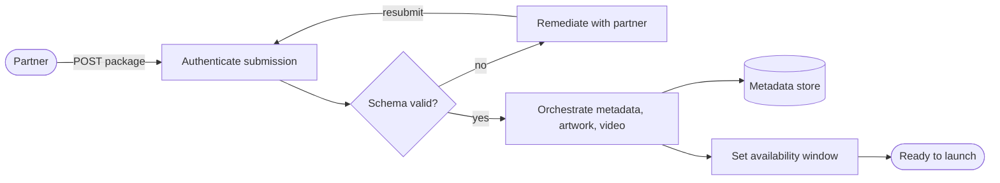
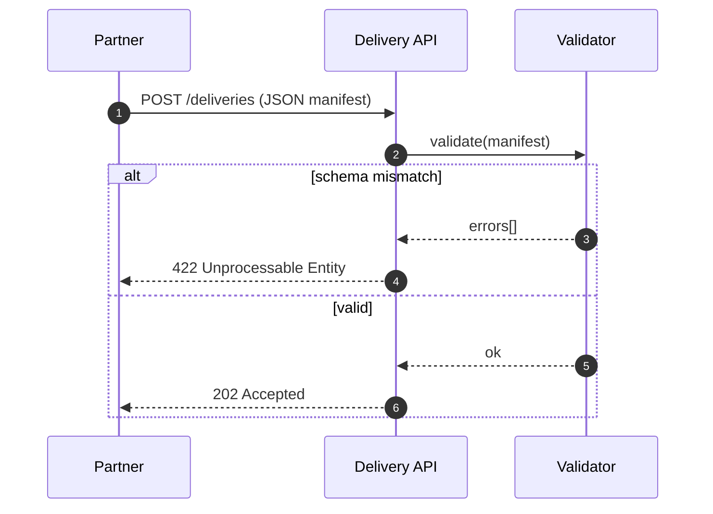

# Partner content delivery

These are the Mermaid sources for the post "Mermaid and diagram-design". GitHub renders them in place. They describe a generic partner content delivery, not any company's internal system.

Block 0: what happens to a delivery between submission and launch.

Block 1: the API exchange behind the "Schema valid?" decision.

After editing a block, redraw it and run `npm run diagrams:check` (see [README.md](README.md)).
